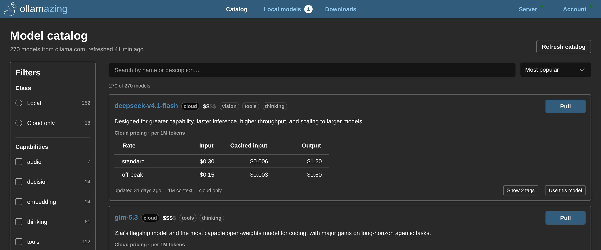
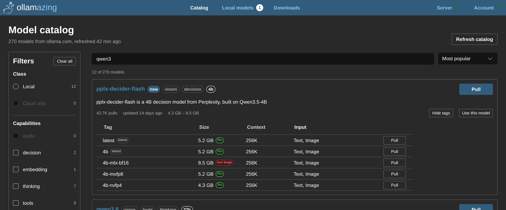
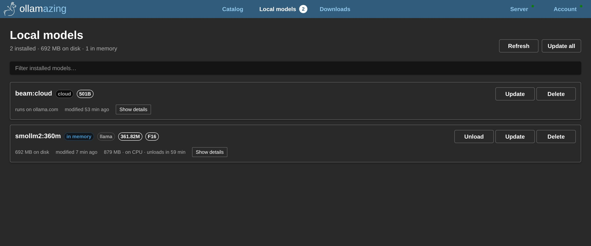
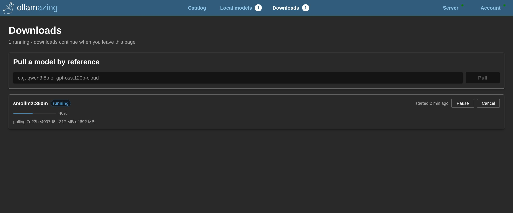
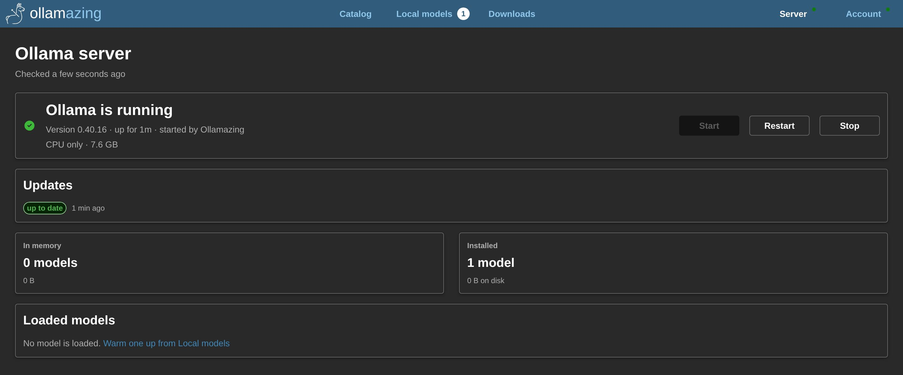
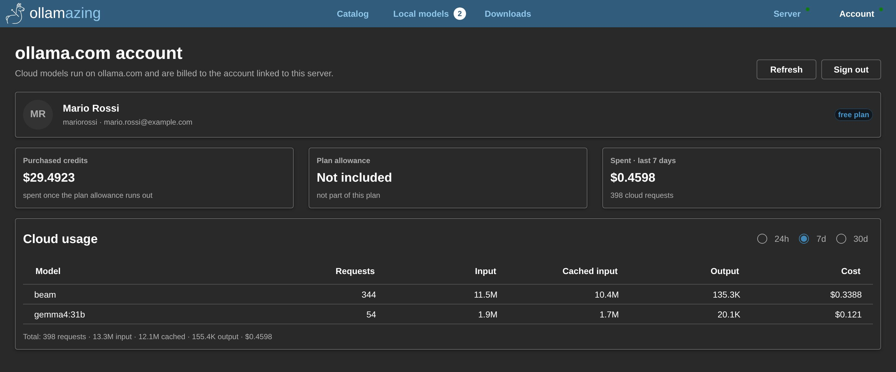

<p align="center"></p>

<p align="center">
  
  
  &nbsp;&nbsp;&nbsp;&nbsp;
  <a href="https://github.com/mdesalvo/Ollamazing/releases/latest"></a>
  <a href="LICENSE"></a>
</p>

Ollamazing puts your whole [Ollama](https://ollama.com) installation in one dashboard. Stop juggling terminal commands and browser tabs: find the right model in the ollama.com catalog, pull it with live progress, run and update the server, keep your local models tidy and link your ollama.com cloud account, all in a few clicks.

<table>
<tr>
<td width="50%" align="center" valign="top"><br/><b>A faceted catalog of every ollama.com model</b><br/>Narrow the list by class, capabilities, parameters, memory and price per million tokens.</td>
<td width="50%" align="center" valign="top"><br/><b>Every tag tells whether it fits</b><br/>On the GPU or in the RAM that Ollama runs on. "Use this model" hands you ready-to-copy snippets for the terminal, curl, Python and any OpenAI-compatible client.</td>
</tr>
<tr>
<td width="50%" align="center" valign="top"><br/><b>Your models, on disk and in memory</b><br/>See what is installed and what sits in memory; warm a model up before you need it, update it or remove it.</td>
<td width="50%" align="center" valign="top"><br/><b>Downloads you can pause and resume</b><br/>Pull any model with live progress, pause it and resume it later. Downloads keep going while you move around the app.</td>
</tr>
<tr>
<td width="50%" align="center" valign="top"><br/><b>Server, hardware and updates at a glance</b><br/>Start and stop the server, see its version and hardware and update Ollama itself in place when a new release is out.</td>
<td width="50%" align="center" valign="top"><br/><b>Cloud credits and usage model by model</b><br/>Link Ollama to your ollama.com account to run cloud models, then keep an eye on your plan.</td>
</tr>
</table>

## Getting started

You need the [.NET 10 SDK](https://dotnet.microsoft.com/download) and [Ollama](https://ollama.com/download). Ollamazing runs on Windows, macOS and Linux.

```bash
dotnet run --project Ollamazing.Web
```

Then open http://localhost:5222. There is no need to start Ollama first: Ollamazing starts it for you when none is running.

## Your ollama.com account

Cloud models are billed to the ollama.com account linked to your Ollama server. Linking works like `ollama signin`: Ollamazing opens ollama.com, where you sign in and approve this device. Your password never passes through Ollamazing, while the key that identifies your server never leaves your machine. Signing out removes the device from your account.

## Settings

All settings live in `Ollamazing.Web/appsettings.json`. The defaults suit an Ollama on the same machine, so most people never need to touch them. Any setting can also be given on the command line:

```bash
dotnet run --project Ollamazing.Web -- --Ollama:BaseUrl=http://192.168.1.10:11434
```

<details>
<summary><b><code>Ollama</code> · the server Ollamazing talks to</b></summary>

| Setting | Default | What it does |
|---|---|---|
| `BaseUrl` | `http://localhost:11434` | Address of the Ollama API; point it to another machine to drive a remote server. |
| `WarmUpKeepAlive` | `60m` | How long **Warm up** keeps a model in memory; `-1` keeps it until the server stops. |
| `StatusPollSeconds` | `3` | How often the dashboard checks the server. |
| `DeviceName` | `Ollamazing` | Name ollama.com shows for this server once the account is linked; empty uses the computer name. |

</details>

<details>
<summary><b><code>ServerControl</code> · running Ollama from Ollamazing</b></summary>

| Setting | Default | What it does |
|---|---|---|
| `StartOnLaunch` | `true` | Starts Ollama together with Ollamazing when no server runs on this machine. |
| `StopOnExit` | `true` | Stops the server Ollamazing started when Ollamazing closes; a server started elsewhere is never touched. |
| `ExecutablePath` | `ollama` | The Ollama program to run, looked up in PATH unless a full path is given. |
| `Environment` | none | Extra variables for that server, such as `"OLLAMA_MODELS": "/data/models"`. |
| `LogFile` | desktop app log | Log of a server started elsewhere, shown on the Server page; Ollamazing also reads from it the hardware Ollama found. |
| `LogLines` | `200` | Lines shown by the log viewer. |
| `UpdateCheckHours` | `24` | How often GitHub is checked for a new Ollama release; `0` turns the check off. |

</details>

<details>
<summary><b><code>Catalog</code> · the ollama.com model catalog</b></summary>

| Setting | Default | What it does |
|---|---|---|
| `DatabasePath` | user data folder | Where the catalog is kept: `~/.local/share/Ollamazing` on Linux, `%LOCALAPPDATA%\Ollamazing` on Windows, `~/Library/Application Support/Ollamazing` on macOS. |
| `CacheTtlHours` | `24` | Age after which the catalog is read again from ollama.com. |
| `MaxConcurrentRequests` | `4` | Pages read in parallel while model sizes load, kept low to be gentle with ollama.com. |
| `BaseUrl` | `https://ollama.com` | Site the catalog is read from. |
| `MaxPages` | `60` | Safety limit on the catalog pages read in one refresh. |

</details>
